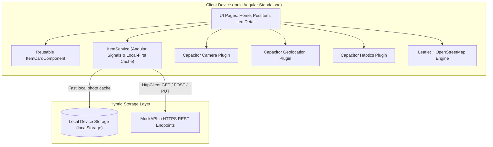

# IT-WS07 Final Case Study Report: FindIt
**Course:** IT-WS07 Mobile Application Technology  
**Program & Campus:** College of Information and Communications Technology (CICT), Nueva Ecija University of Science and Technology (NEUST)  
**Project Repository & Google Drive Link:** [https://github.com/jsoul-dev/find-it](https://github.com/jsoul-dev/find-it) | `[Insert Google Drive Folder URL]`  

---

## 1. Project Information

### Title
**FindIt: Campus Lost & Found Mobile Application**

### Group Members
| Member Name | Student ID |
|---|---|
| `[Student 1 Name]` | `[Student ID]` |
| `[Student 2 Name]` | `[Student ID]` |
| `[Student 3 Name]` | `[Student ID]` |
| `[Student 4 Name]` | `[Student ID]` |

---

## 2. Problem and Proposed Solution

### The Campus Problem
In academic environments such as the NEUST campus, lost and found personal belongings (e.g., student IDs, tumblers, umbrellas, calculators, lab equipment) are traditionally managed via word of mouth, physical bulletin boards, or unorganized social media posts. This informal approach presents three severe shortcomings:
1. **Lack of Geographic Context:** A post stating "found near the canteen" fails to indicate the exact bench or vicinity, forcing students to search blindly.
2. **Ambiguous Descriptions Without Visuals:** Text descriptions alone (e.g., "blue umbrella") often lead to multiple students claiming the same item or failing to recognize their own property without visual verification.
3. **Delayed Resolution:** Without structured status tracking, students cannot determine whether an item is still missing or has already been returned.

### Intended Users
- **Students and Faculty:** Everyday campus occupants who lose personal items or discover unattended belongings on campus grounds.
- **Campus Security Personnel and Department Staff:** Designated personnel operating guard houses and student affairs offices who record found items turned over to them, attach visual evidence, and mark items as "Claimed" upon return.

### Proposed Solution
**FindIt** is a focused, cross-platform mobile application developed with the **Ionic Framework**, **Angular Standalone**, and **Capacitor**. It provides a centralized, real-time Lost & Found registry connected to a cloud-hosted REST API:
- **Instant Reporting with Geographic Pinning:** Users post reports with descriptions, contact info, and an exact GPS pin via Capacitor Geolocation and an interactive Leaflet map.
- **Visual Verification via Camera Integration:** Users can snap or attach photos using **Capacitor Camera** (`@capacitor/camera`). Photos are saved with a **hybrid local-first architecture**: high-resolution images are preserved on the local device via `localStorage`, while an optimized thumbnail is synced to the REST API for remote viewing.
- **Shared Live Registry:** All reports synchronize with an HTTPS cloud REST API (`MockAPI.io`), allowing immediate discovery across the entire campus.
- **Real-Time Keyword Search & Filtering:** Reports can be searched by keyword (name, description, location) via an integrated `ion-searchbar` and filtered instantaneously by category (**Lost**, **Found**, **Claimed**) using reactive Angular signals.
- **Tactile Feedback:** Capacitor Haptics provides purposeful physical vibrations indicating operational success, input validation warnings, and network/hardware errors.

---

## 3. Application Features & User Flows

The application is structured into three primary views:

```
[Home Page (Items List & Map)]
    │
    ├── (Tap "+ FAB") ───────────► [Post Item Page]
    │                                   │ (Attach Photo via Camera)
    │                                   │ (GPS Pin / Tap Map)
    │                                   ▼ (Submit via POST)
    │
    └── (Tap Item Card) ─────────► [Item Detail Page]
                                        │ (View Full Photo & Map Pin)
                                        ▼ (Mark as Claimed via PUT)
```

### 1. Home / Items List (`/home`)
- **Campus Statistics & Metrics Dashboard:** A 4-card interactive statistics overview summarizing **Total Items**, **Lost Items**, **Found Items**, and **Claimed Belongings** using reactive Angular `computed()` signals. Each card doubles as an instant filter toggle with full keyboard navigation and high-contrast color indicators.
- **Collapsible Campus Map:** OpenStreetMap view centered on NEUST Sumacab Campus (`15.44825, 120.93922`), toggleable via a "View Map / Hide Map" button to keep the primary screen uncluttered and performant.
- **Visual Section Divider:** A prominent structural divider separating the high-level metrics dashboard from the live feed of reported belongings, complete with an icon and live count badge (`X items`).
- **Live Keyword Search Bar:** An `ion-searchbar` enables instantaneous real-time querying across item names, descriptions, and contact/location notes with debounced input.

- **Segmented Filter Bar:** An `ion-segment` allows instantaneous switching between **All**, **Lost**, **Found**, and **Claimed** records.
- **Live Item Cards:** Reusable `ItemCardComponent` displays item photo thumbnails, item name, description, contact details, a colored type badge (`Lost` in red, `Found` in green), and status indicator (`Open` or `Claimed`).
- **System States:** Clear UI feedback displaying an `ion-spinner` during initial data load, an empty state message when no items match a selected filter, and an error card with a **Retry** button if network connectivity fails.
- **Navigation:** Floating Action Button (FAB) at the bottom right that routes directly to `/post-item`.

### 2. Post Item Page (`/post-item`)
- **Report Form:** Fields bound using Angular `[(ngModel)]` for Report Type (`Lost` or `Found`), Item Name, Description, and Contact Information.
- **Photo Capture via Camera:** "Attach Item Photo" button triggers Capacitor Camera to capture a photo from the device camera or photo library with immediate image preview and removal option.
- **"Locate Me" GPS Integration:** Tapping the "Locate Me" button triggers Capacitor Geolocation to query the device's hardware GPS, recentering the Leaflet map to the user's physical coordinates and dropping a single `circleMarker`.
- **Manual Pin Fallback:** Users can tap directly on the Leaflet map to drop or reposition the pin.
- **Client-Side Form Validation:** Enforces non-empty values for name, contact, and geographic coordinates prior to submitting the HTTP POST request. Triggers a warning message and a haptic warning vibration if validation fails.

### 3. Item Detail Page (`/item-detail/:id`)
- **Full Metadata & Visuals:** Displays high-resolution item photograph, name, description, contact details, and status badge.
- **Dedicated Location Map:** Renders a focused Leaflet map centered at the item's saved latitude and longitude, featuring a marker popup.
- **Resolution Action:** For items with status `Open`, an authorized user or guard can tap **Mark as Claimed**, which issues an HTTP `PUT` request to update the status to `Claimed` in the cloud database.

---

## 4. Technical Implementation

### Stack and Architectural Roles
- **Ionic Framework (v9):** Mobile-first UI components (`ion-header`, `ion-toolbar`, `ion-content`, `ion-card`, `ion-segment`, `ion-button`, `ion-fab`, `ion-badge`, `ion-img`).
- **Angular (Standalone Architecture):** Standalone components (no `NgModule`), signal-based reactive state (`signal`, `computed`), new control flow syntax (`@for`, `@if`), and `inject()`-based dependency injection.
- **Capacitor (v8) Mobile Capabilities (3 Hardware Plugins):**
  1. `@capacitor/camera`: Camera and gallery photo acquisition (`Camera.getPhoto()`) with PWA browser fallback.
  2. `@capacitor/geolocation`: Coordinates acquisition (`getCurrentPosition()`).
  3. `@capacitor/haptics`: Physical vibration feedback (`Haptics.notification()`).
- **Leaflet (v1.9):** High-performance interactive map engine utilizing OpenStreetMap tiles.
- **MockAPI.io REST API:** Cloud-hosted HTTPS REST API providing real-time persistence across devices without requiring local XAMPP/PHP servers.



### Core Code Snippets & Implementation Details

#### 1. Camera Capture & Canvas Compression (`post-item.page.ts`)
To adhere to MockAPI.io's strict ~100KB request body payload limitation while preventing HTTP 413 `Payload Too Large` errors, captured photos are downscaled on an off-screen HTML5 Canvas down to a maximum width of 300px at 0.45 JPEG quality (~10–15KB):

```typescript
async takePhoto(): Promise<void> {
  try {
    const image = await Camera.getPhoto({
      quality: 40,
      allowEditing: false,
      resultType: CameraResultType.DataUrl,
      source: CameraSource.Prompt,
      width: 400,
    });
    if (image.dataUrl) {
      const compressed = await this.compressPhoto(image.dataUrl, 300, 0.45);
      this.photo.set(compressed);
    }
  } catch {
    this.formError.set('Camera was cancelled or unavailable.');
  }
}
```

Furthermore, if the cloud REST API ever rejects a submission with HTTP 413, FindIt executes an automatic local-first fallback: the full photo is preserved locally in `localStorage` under the user's session, and the record is posted with clear text metadata to guarantee student reports are never lost.

#### 2. Hybrid Local-First Photo Persistence (`services/item.ts`)
Caches full photos locally by ID while synchronizing compact payloads to the REST backend:
```typescript
saveLocalPhoto(id: string, dataUrl: string): void {
  try {
    localStorage.setItem(`findit_photo_${id}`, dataUrl);
  } catch {}
}

getPhoto(item: Item): string | undefined {
  try {
    const local = localStorage.getItem(`findit_photo_${item.id}`);
    if (local) return local;
  } catch {}
  return item.photo;
}
```

#### 3. Geolocation and Single Marker Logic (`post-item.page.ts`)
```typescript
async locateMe(): Promise<void> {
  try {
    const position = await Geolocation.getCurrentPosition();
    const lat = position.coords.latitude;
    const lng = position.coords.longitude;
    this.map.setView([lat, lng], 17);
    this.updateMarker(lat, lng);
    this.formError.set('');
  } catch {
    this.formError.set('Could not access GPS. Please check permissions or tap the map.');
    await Haptics.notification({ type: NotificationType.Error });
  }
}
```

#### 4. ItemService with Signals and HttpClient (`services/item.ts`)
```typescript
@Injectable({ providedIn: 'root' })
export class ItemService {
  private http = inject(HttpClient);
  private url = environment.apiUrl;

  items = signal<Item[]>([]);
  loading = signal<boolean>(false);
  error = signal<string>('');

  fetchItems(): void {
    this.loading.set(true);
    this.error.set('');
    this.http.get<Item[]>(this.url).subscribe({
      next: (res) => {
        this.items.set([...res].reverse());
        this.loading.set(false);
      },
      error: async () => {
        this.error.set('Could not load items. Check your internet connection.');
        this.loading.set(false);
        await Haptics.notification({ type: NotificationType.Error });
      },
    });
  }

  addItem(newItem: NewItem): Observable<Item> {
    return this.http.post<Item>(this.url, newItem);
  }

  markClaimed(item: Item): Observable<Item> {
    return this.http.put<Item>(`${this.url}/${item.id}`, { ...item, status: 'Claimed' });
  }
}
```

---

## 5. Testing and Evaluation

### Test Table Execution Results

| # | Feature / Task Tested | Expected Result | Actual Result | Status |
|---|---|---|---|:---:|
| 1 | **Open app, load items (GET)** | Items load from MockAPI with Lost/Found badges and map renders | All seed items loaded immediately; map rendered at campus coordinates | **Pass** |
| 2 | **API unreachable (Airplane Mode)** | Error container with retry button appears; app does not crash | Error text displayed with a primary "Retry" button; error haptic fired | **Pass** |
| 3 | **Filter: Lost / Found / Claimed** | List dynamically updates to show only matching records | Segment switches instantly update the displayed cards with zero lag | **Pass** |
| 4 | **Post with empty name/contact** | Form displays error message and triggers warning haptic | Error text displayed; phone vibrated with Warning haptic; no POST made | **Pass** |
| 5 | **Locate Me (Permission Granted)** | Map centers on user's GPS; single circleMarker dropped | Map smoothly animated to device GPS location and pinned marker | **Pass** |
| 6 | **Locate Me (Permission Denied)** | Error message displayed and error haptic triggered | Prompt handled gracefully; error banner shown; map remains interactive | **Pass** |
| 7 | **Attach Photo via Camera / Gallery** | Camera/Gallery prompt opens; captured image renders in preview | Photo snapped, thumbnail previewed; remove button functions correctly | **Pass** |
| 8 | **Submit valid item with photo (POST)** | Success haptic vibrates; item added to API with local photo cache | Success haptic fired; routed to Home; new item appears with photo thumbnail | **Pass** |
| 9 | **Open Item Detail page** | Details, attached photo, and focused Leaflet map marker display | Full photo, metadata, and map centered on exact coordinates loaded | **Pass** |
| 10 | **Mark as Claimed (PUT)** | Status badge updates to "Claimed" and Claim button disappears | Status updated on cloud API and UI badge changed to Claimed immediately | **Pass** |

### Automated End-to-End (E2E) Test Suite (Playwright)
In addition to physical device verification, an automated Playwright test suite (`npm run test:e2e`) executes in a simulated mobile Chrome environment (`Pixel 7` viewport):
- **Test 1:** Verifies Home screen header and all 4 segment buttons (`All`, `Lost`, `Found`, `Claimed`).
- **Test 2:** Verifies the Leaflet campus map container (`#map`) mounts and renders.
- **Test 3:** Verifies `/post-item` form cards, photo button, GPS locate trigger, and submit button.
- **Test 4:** Verifies live keyword search input filtering across item cards.
- **Execution Result:** 4/4 automated E2E tests passing.

### Limitations and Usability Issues
1. **MockAPI.io 100KB Request Body Limit & Image Compression:** MockAPI.io free tier enforces a strict ~100KB aggregate payload limit per POST/PUT request. Because raw mobile camera photos typically span 2MB to 8MB, direct Base64 encoding triggers an HTTP 413 (Payload Too Large) error. To ensure dependable cloud synchronization, the app applies client-side HTML5 Canvas compression down to 300px width at 0.45 JPEG quality (~10–15KB). While sufficient for visual verification on mobile screens, fine text (e.g. tiny student ID numbers or serial codes) is compressed. In production, this would be superseded by dedicated object storage (Firebase Storage / AWS S3) storing only lightweight image URLs in the database.
2. **Duplicate Entry Policies:**
   - *Submission Concurrency Prevention:* Accidental double-posts from rapid taps are fully prevented on the client side via the `[disabled]="submitting()"` signal lock on the submit button.
   - *Domain Duplicate Tolerance:* MockAPI provides no unique database constraints, and FindIt deliberately allows similar item titles without server deduplication. In an active campus environment, multiple students may lose or find identical items (e.g., standard Casio calculators, black umbrellas, or PE uniforms) in separate instances, meaning strict title deduplication would incorrectly reject genuine reports.
3. **Unauthenticated Public API:** MockAPI.io endpoints are publicly writable. Any client knowing the URL can theoretically issue POST/PUT requests.
4. **Online Map Tile Caching:** OpenStreetMap tiles require active internet access. When offline, uncached regions show a blank grid.

### Proposed Improvements (CO4)
1. **Dedicated Cloud Storage (Firebase Storage / AWS S3):** Upload original high-resolution photos to dedicated cloud storage buckets and save immutable image URLs to the database.
2. **Firebase Authentication / JWT:** Implement student authentication using official school email credentials (`@neust.edu.ph`) to prevent unauthorized posts.
3. **Push Notifications via Cloud Messaging:** Notify registered users when a new item matching a category or keyword is reported found near their department.
4. **Offline Map Storage:** Cache Vector/Raster map tiles locally using SQLite or IndexedDB to enable full offline map browsing.

---

## 6. AI Usage Disclosure

In compliance with the assignment brief's guidelines on responsible AI use:

| Dimension | Disclosure Details |
|---|---|
| **AI Tools Consulted** | Claude Opus 4.6 (Planning & Architecture Analysis), Gemini 3.8 Flash (Implementation Scaffolding) |
| **Tasks Assisted by AI** | Formulating the 10-milestone project plan, configuring Angular Standalone route structure, generating TypeScript scaffolding, integrating Leaflet and Camera PWA elements. |
| **Work Authored / Tested by Group** | Architecting the hybrid local-first photo storage strategy; configuring the MockAPI dashboard; testing Camera, GPS permissions, physical vibration, and map interactivity on actual Android hardware; compiling the native Android project in Android Studio; and authoring this technical report. |
| **Security & Privacy Statement** | No personal passwords, private tokens, or proprietary credentials were shared with any AI tools. The public MockAPI endpoint is explicitly designed for public demo testing. |

---

## 7. Installation Instructions (For Course Instructor)

1. **Download the APK:** Download the provided `FindIt-v1.0.apk` file from our shared Google Drive folder.
2. **Allow Sideloading:** On your Android device, enable **"Install unknown apps"** for your file manager or browser.
3. **Install the APK:** Tap on `FindIt-v1.0.apk`. If Google Play Protect presents an *Unrecognized app* alert, tap **"More details"** and select **"Install anyway"**.
4. **Grant Permissions:** Upon launching the app, tap **"Allow"** when prompted for Location and Camera access.
5. **Connectivity:** The app connects to our live HTTPS MockAPI endpoint; please ensure Wi-Fi or Mobile Data is active during testing.
